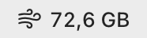
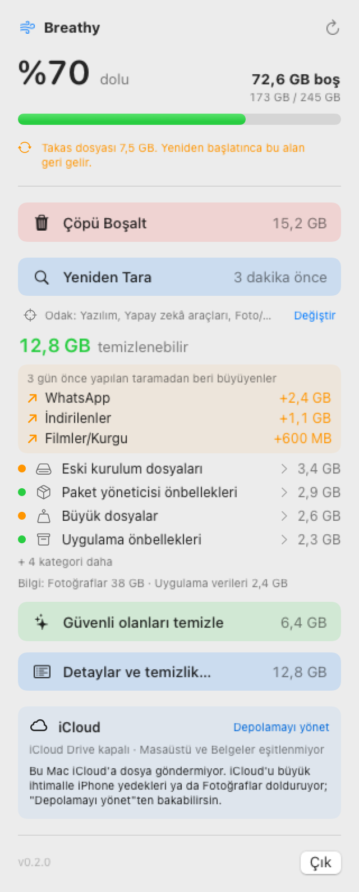
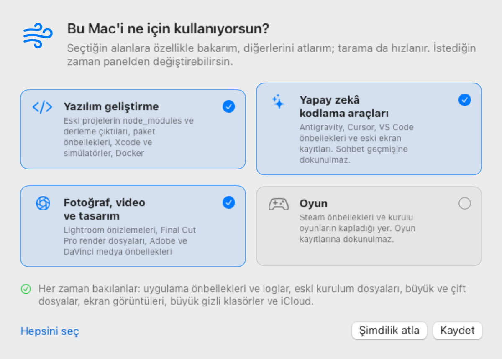
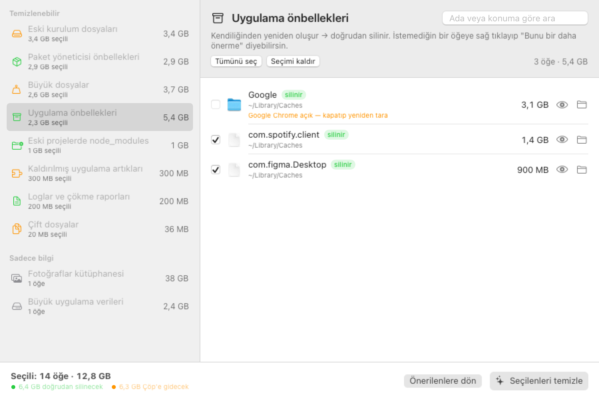

# Breathy

**Mac'ine nefes aldır.** Breathy, menü çubuğunda duran küçük bir yardımcı. Diskinin ne kadar dolu olduğunu her an gösterir, yer kaplayan gereksiz dosyaları bulur ve onları senin onayınla temizler.

  

  

## Neden?

Disk dolunca neyin yer kapladığını bulmak zordur. Asıl yer kaplayanlar genelde göremediğin yerlerdedir: uygulamaların biriktirdiği önbellekler, aylardır açmadığın eski projelerin kalıntıları, kurduktan sonra unuttuğun dosyalar, aynı belgenin kopyaları, kaldırdığın uygulamalardan geride kalanlar.

Breathy bunların hepsine bakar ve sana anlaşılır bir liste sunar: neyin ne kadar yer kapladığını, silmenin güvenli olup olmadığını ve neden önerildiğini.

**Gerçek bir örnek:** Breathy'nin geliştirildiği Mac'te diskin %95'i doluydu, sadece 11 GB boş yer kalmıştı. Birkaç temizlikten sonra boş yer 70 GB'ı geçti. Açılan yerin neredeyse tamamı önbelleklerden, eski proje kalıntılarından ve bir yapay zekâ aracının aylardır kullanılmayan kopyalarından geldi.

## Neler yapar?

- **Her an görünür:** Menü çubuğunda boş alanı gösterir. Panelde doluluk yüzdesi ve renkli bir çubuk vardır.
- **Tek tıkla Çöp:** Çöp'ün ne kadar yer kapladığını gösterir, tek tıkla boşaltır.
- **Akıllı tarama:** Bir dakika içinde bütün ev klasörünü tarar ve bulduklarını gruplara ayırır.
- **Güvenli temizlik:** Kendiliğinden yeniden oluşan dosyaları (önbellekler, loglar) siler. Senin dosyalarını ise sadece Çöp'e taşır, istersen geri alabilirsin.
- **Ne büyüdü?:** Son taramadan beri en çok büyüyen klasörleri gösterir. Örneğin "WhatsApp +2,4 GB".
- **"Sistem Verileri" ne?:** Depolama ayarlarında açıklamasız duran o büyük kalemi parçalarına ayırır: uygulama verileri, önbellekler, takas dosyası, Docker, iPhone yedekleri ve macOS'un gerektiğinde kendisinin sileceği alan.
- **Kullandığın önbelleğe dokunmaz:** Sadece uzun süredir kullanılmayan önbellekleri önerir. Silinince hemen yeniden oluşacak olanları ve ses eklentisi taramaları gibi yeniden kurulması uzun sürenleri işaretlemez.
- **Temizlik geçmişi:** Neyin ne zaman silindiğini, ne kadar yer açıldığını ve neyin Çöp'e gittiğini kaydeder.
- **iCloud'u anlar:** iCloud'unu neyin doldurduğunu ve ekran görüntülerinin nereye kaydedildiğini gösterir.
- **Zamanında haber verir:** Boş yer 10 GB'ın altına inince bir kez uyarır.
- **Kendini günceller:** Yeni sürüm çıkınca panelde **Güncelle** düğmesi belirir.

## Senin kullanımına göre tarar

İlk açılışta Breathy bu Mac'i ne için kullandığını sorar. Seçtiğin alanlara özellikle bakar, diğerlerini atlar. Böylece sonuçlar sana göre olur ve tarama hızlanır.

  

| Alan | Breathy neye bakar |
|---|---|
| Herkes için (her zaman) | Uygulama önbellekleri ve loglar, eski kurulum dosyaları, unutulmuş büyük dosyalar, aynı dosyanın kopyaları, eski ekran görüntüleri, kaldırılmış uygulamaların artıkları, büyük gizli klasörler |
| Yazılım geliştirme | Aylardır dokunulmamış projelerin indirilmiş paketleri ve derleme çıktıları, paket önbellekleri, Xcode ve simülatör artıkları. Docker'da hiçbir container'ın kullanmadığı imajları tek tıkla temizler; container'lara ve verilere dokunmaz. |
| Yapay zekâ kodlama araçları | Antigravity, Cursor ve VS Code'un önbellekleri ve eski ekran kayıtları. Sohbet geçmişine ve planlara dokunulmaz. |
| Fotoğraf, video ve tasarım | Lightroom önizlemeleri, Final Cut Pro render dosyaları, Adobe ve DaVinci önbellekleri |
| Oyun | Steam önbellekleri ve kurulu oyunların kapladığı yer. Oyun kayıtlarına dokunulmaz. |

## Nasıl kullanılır?

1. **İndir:** [Releases](../../releases/latest) sayfasından Breathy'yi indir, `Breathy.app`'i Uygulamalar klasörüne sürükle ve aç. Uygulama App Store'dan gelmediği için ilk açılışta Sistem Ayarları → Gizlilik ve Güvenlik → **Yine de Aç** demen gerekir. Bunu sadece bir kez yaparsın.
2. **İzin ver:** Breathy'nin klasörleri görebilmesi için bir izin gerekir. Panel seni adım adım ayarlara yönlendirir.
3. **Kullanım alanını seç:** Yazılım, yapay zekâ araçları, fotoğraf/video ya da oyun. Hiçbirini seçmesen de günlük kullanım her zaman taranır.
4. **Tara:** Menü çubuğundaki rüzgâr simgesine bas, **Taramayı Başlat**'a tıkla.
5. **Temizle:** **Güvenli olanları temizle** ile tek tıkla temizleyebilirsin. Ya da **Detaylar**'ı açıp tek tek seçebilirsin; her dosyayı önizleyebilir, Finder'da görebilirsin.
6. **Çöp'ü boşalt:** Çöp'e taşınanlar, Çöp'ü boşaltınca yer açar.

  

## Güvende misin?

- **Sen onaylamadan hiçbir şey silinmez.** Otomatik ya da zamanlanmış silme yoktur.
- **Senin dosyaların Çöp'e gider.** Belgeler, fotoğraflar, videolar asla doğrudan silinmez.
- **Önemli dosyalar korunur:** Şifre kasaları, gizli anahtarlar, kurtarma kodları ve benzeri hassas dosyalar kırmızı **kritik** etiketiyle gösterilir. Breathy onları hiçbir zaman seçmez ve silmez. Bunları tanımak için yapılan bütün kontroller Mac'in içinde yapılır, hiçbir şey internete gönderilmez.
- **Önemli yerlere dokunmaz:** Fotoğraflar arşivi, Mail, Mesajlar, iCloud Drive, şifreler ve uygulamaların sohbet geçmişleri korunur.
- **Açık uygulamalara saygı duyar:** Çalışan bir uygulamanın verisi silinmez. Önce kapatman istenir.
- **Her kopyadan biri kalır:** Aynı dosyanın kopyalarından en az biri her zaman korunur.
- **Bilgisayarı yavaşlatmaz:** Arka planda tarama yapmaz, sadece sen istediğinde çalışır. Boştayken neredeyse hiç kaynak kullanmaz.
- **Verin sende kalır:** Breathy internete sadece yeni sürüm var mı diye bakmak için bağlanır.

## Gereken

macOS 14 (Sonoma) ya da daha yenisi. Apple Silicon ve Intel Mac'lerde çalışır.
